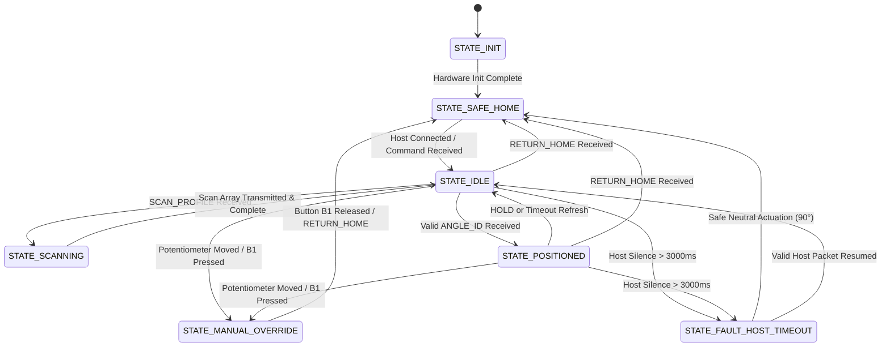

# LumiTrack System Architecture & Technical Design

## Variant 10.03: Museum Exposure Limiter
**Parent Problem:** P10 – LumiTrack: Intelligent Light Mapping and Positioning System  
**Target Hardware:** STMicroelectronics STM32 NUCLEO-F446RE (ARM Cortex-M4F @ 180 MHz)  
**Host Environment:** Python 3.11+ / Scikit-Learn / Streamlit / Serial VCP  

---

## 1. Executive Summary & Engineering Objective

In museum conservation, historic artifacts (oil paintings, illuminated manuscripts, watercolors, textiles) suffer irreversible photochemical and photothermal degradation when subjected to excessive cumulative radiant flux. 

Standard light control systems typically deploy a static blind or a fixed threshold light switch. However, ambient museum conditions fluctuate dynamically between:
1. **Safe Diffuse Light** (ambient gallery daylight, visitors can view the exhibit).
2. **Hazardous Direct Solar/Spotlight Beams** (direct sunbeams penetrating skylights or high-intensity spotlights exceeding safe lux-hour conservation budgets).
3. **Deceptive Specular Reflections** (narrow specular glints bouncing off protective glass cabinets, or transient shadows from passing visitors).

**LumiTrack Variant 10.03** implements a closed-loop cyber-physical system combining:
- A deterministic, hard-real-time STM32 microcontroller managing a 50 Hz servo PWM and 12-bit ADC sensor array over an approved discrete angle grid.
- A host machine learning classifier that separates genuine hazardous light regimes from specular confusers and commands optimal protective louver angles.
- A confidence-aware early-stopping partial scan policy that halves light mapping duration and protects the artwork faster.

---

## 2. System Level Architecture

```
+----------------------------------------------------------------------------------------------------+
|                                      PHYSICAL TEST FIXTURE                                         |
|                                                                                                    |
|  [Diffused Ambient / Direct Spotlight / Specular Source] ---> [Museum Showcase & Louver Shade]     |
|                                                                     ^                              |
|                                                                     | SG90/MG90S Servo             |
|                                                                     | (50 Hz PWM, 3.3V Logic)      |
+---------------------------------------------------------------------|------------------------------+
                                                                      |
+---------------------------------------------------------------------|------------------------------+
|                        STM32 NUCLEO-F446RE FIRMWARE (HARD REAL-TIME LAYER)                         |
|                                                                                                    |
|   +-----------------------+     +------------------------+     +-------------------------------+   |
|   | ADC1 (PA0, PA1)       |     | TIM3_CH1 (PA6)         |     | Safety Supervisor             |   |
|   | - LDR Light Sensor    |     | - Prescaler: 89        |     | - Approved Angle Validator    |   |
|   | - 10k Potentiometer   |     | - Period: 19999 (20ms) |     | - 3000ms Host Watchdog Timer  |   |
|   | - 16x Oversampling    |     | - Slew Rate Limiter    |     | - Safe Neutral Fallback (90°) |   |
|   | - Digital Filtering   |     | - Settling Supervisor  |     | - Manual Override Lockout     |   |
|   +-----------+-----------+     +-----------^------------+     +---------------+---------------+   |
|               |                             |                                  ^                   |
|               +----------------------+      |                                  |                   |
|                                      v      |                                  |                   |
|                         +------------+------+----------------------------------+                   |
|                         |  Canonical State Machine & Command Dispatcher        |                   |
|                         |  States: INIT, SAFE_HOME, IDLE, SCANNING,            |                   |
|                         |          POSITIONED, MANUAL_OVERRIDE, FAULT_TIMEOUT  |                   |
|                         +---------------------------+--------------------------+                   |
|                                                     |                                              |
|                                                     v                                              |
|                         +------------------------------------------------------+                   |
|                         | USART2 ST-LINK VCP @ 115200 Baud (PA2 TX / PA3 RX)   |                   |
|                         | - Canonical Host Contract:                           |                   |
|                         |   ANGLE_ID | SCAN_PROFILE | HOLD | RETURN_HOME       |                   |
|                         +---------------------------+--------------------------+                   |
+-----------------------------------------------------|----------------------------------------------+
                                                      | USB Virtual COM Port (JSON Telemetry & Frames)
                                                      v
+----------------------------------------------------------------------------------------------------+
|                               HOST PC SOFTWARE (INTELLIGENCE & IOT LAYER)                          |
|                                                                                                    |
|   +------------------------------------+        +-----------------------------------------------+  |
|   | Host Controller Bridge             |        | Real-Time ML Inference Engine                 |  |
|   | - Background Rx Worker Thread      |------->| - Feature Extractor (12 physical scan features)|  |
|   | - Keep-alive Watchdog Supervisor   |        | - Random Forest Classifier (100 Trees)        |  |
|   | - CRC & Sequence Tracking          |        | - Ridge Logistic Regression Baseline          |  |
|   +------------------------------------+        | - Partial Scan Early Stopping (POS_0 to POS_3)|  |
|                     |                           +-----------------------+-----------------------+  |
|                     |                                                   |                          |
|                     v                                                   v                          |
|   +---------------------------------------------------------------------------------------------+  |
|   | User Interfaces & Telemetry Analytics                                                       |  |
|   | - Streamlit Interactive Web Dashboard (Polar profile, live cumulative lux-hours meter)      |  |
|   | - Terminal CLI Live Monitor (ANSI live status gauge)                                        |  |
|   | - Virtual STM32 Mock Emulator (Full Software-in-the-Loop test harness)                       |  |
|   +---------------------------------------------------------------------------------------------+  |
+----------------------------------------------------------------------------------------------------+
```

---

## 3. Firmware State Machine Specification

The firmware implements a strict Mealy/Moore finite state machine adhering to failsafe embedded requirements:



### State Definitions:
1. `STATE_INIT`: Power-on reset, clock PLL setup to 180 MHz, GPIO/ADC/TIM/UART configuration.
2. `STATE_SAFE_HOME`: Servo parked at neutral baseline (POS_3, 90°). Green LED pulses at 1 Hz.
3. `STATE_IDLE`: Waiting for scan trigger or host command.
4. `STATE_SCANNING`: Actively sweeping approved angle grid, taking settled ADC readings, and compiling scan profile.
5. `STATE_POSITIONED`: Louver held at host-validated safe angle (`ANGLE_ID 0..6`).
6. `STATE_MANUAL_OVERRIDE`: Hardware potentiometer or blue button B1 overrides host. All host positioning commands rejected with `ERR_MANUAL_OVERRIDE_ACTIVE`.
7. `STATE_FAULT_HOST_TIMEOUT`: Host communication timed out (>3000 ms). System automatically drives servo to safe neutral (90°) and blinks LED at 10 Hz alert rate.

---

## 4. Mathematical Modeling & Photometric Equations

### 4.1. LDR Analog Conversion & Digital Filtering
The light-dependent resistor (GL5528) is arranged in a voltage divider with fixed reference resistor $R_{\text{fixed}} = 10\text{ k}\Omega$:
$$V_{\text{out}} = V_{\text{DD}} \cdot \frac{R_{\text{fixed}}}{R_{\text{LDR}} + R_{\text{fixed}}}$$
Where $V_{\text{DD}} = 3.3\text{ V}$. The 12-bit ADC converts this to a digital reading:
$$\text{ADC}_{\text{raw}} \in [0, 4095], \quad V_{\text{meas}} = \frac{\text{ADC}_{\text{raw}}}{4095} \cdot 3.3\text{ V}$$

To eliminate 50 Hz/60 Hz AC fluorescent/LED lighting ripple, the firmware executes $16\times$ oversampling:
$$\overline{\text{ADC}} = \frac{1}{16}\sum_{i=1}^{16} \text{ADC}_i$$

Illuminance is modeled via empirical power law:
$$E_{\text{lux}} = 500.0 \cdot \left(\frac{V_{\text{meas}}}{3.3 - V_{\text{meas}} + \epsilon}\right)^{1.25}$$

### 4.2. Cumulative Exposure Conservation Integral
According to CIE (Commission Internationale de l'Éclairage) publication CIE 157:2004 (*Control of Damage to Museum Objects by Optical Radiation*), photochemical damage is strictly proportional to cumulative luminous exposure $H$:
$$H(t) = \int_{0}^{t} E(\tau)\,d\tau \approx \sum_{k=1}^{N} E_k \cdot \Delta t$$
Where:
- $H$ is cumulative exposure in lux-seconds (or lux-hours).
- $E_k$ is the instantaneous illuminance measured at interval $\Delta t = 0.05\text{ s}$ (50 ms).
- If $H(t) \ge H_{\text{target}}$ (configured via potentiometer), the system declares conservation exceedance and clamps louver aperture to safe minimum exposure.

### 4.3. Angular Light-Field Profile & Spatial Gradients
Across the 7 approved angles $\theta \in \{15^\circ, 40^\circ, 65^\circ, 90^\circ, 115^\circ, 140^\circ, 165^\circ\}$:
$$\nabla_\theta E = \frac{|E(\theta_{i+1}) - E(\theta_i)|}{\theta_{i+1} - \theta_i} \quad \left[\frac{\text{Lux}}{\text{deg}}\right]$$
- **Diffuse Ambient:** Smooth distribution, low maximum gradient ($\max \nabla_\theta E < 3.0\text{ Lux/deg}$).
- **Direct Beam:** Wide elevation above threshold, broad peak.
- **Specular Confuser:** High localized gradient ($\max \nabla_\theta E > 15.0\text{ Lux/deg}$), narrow spike width, low total integral.
