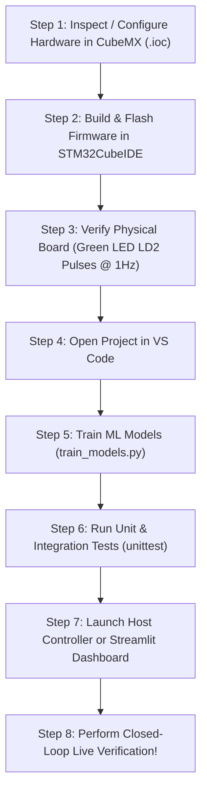

# How STM32CubeMX, STM32CubeIDE, and VS Code Work Together

## A Beginner-Friendly System Integration Guide

---

## 1. Do All Three Applications Need to Run Simultaneously?

**No. They do NOT need to run at the same time.**

Each tool owns a distinct, dedicated stage in the engineering lifecycle. They do not talk to each other through background sockets or shared memory; instead, they interact through **shared files** and the **physical USB serial interface**.

| Tool | Primary Role | Files it Touches / Produces | Does it need to stay open? |
| :--- | :--- | :--- | :--- |
| **STM32CubeMX** | Peripheral & Pinout Generator | `LumiTrack_F446RE.ioc` $\rightarrow$ Generates C initialization headers & drivers | **No.** Close it after generating configuration. *(Note: STM32CubeIDE already integrates CubeMX internally!)* |
| **STM32CubeIDE** | C/C++ Compiler, Linker, ST-LINK Flasher | Compiles `Core/Src/*.c` $\rightarrow$ Generates `.elf` / `.bin` and flashes MCU memory via ST-LINK | **Only during flashing/debugging.** Once firmware is flashed onto the STM32, the MCU retains it in non-volatile flash and runs standalone. |
| **Visual Studio Code** | Python ML Pipeline, IoT Host Engine, Dashboards | Runs `train_models.py`, `dashboard_app.py`, `host_controller.py`, `.ipynb` | **Yes, when running the host application.** VS Code runs the PC-side intelligence that talks to the board over USB. |

---

## 2. Individual Roles & Information Flow

```
[STAGE 1: HARDWARE CONFIGURATION]
         STM32CubeMX (or CubeIDE IOC Editor)
                 |
                 | (Generates Pinout, Clock Tree & HAL Driver Init)
                 v
[STAGE 2: EMBEDDED FIRMWARE BUILD & FLASH]
         STM32CubeIDE
                 |
                 | (Compiles C source files with arm-none-eabi-gcc)
                 | (Flashes binary into STM32F446RE Flash via ST-LINK USB)
                 v
+-------------------------------------------------------------+
|                STM32 NUCLEO-F446RE HARDWARE                 |
|                                                             |
|  - Reads LDR & Potentiometer ADC (50 Hz)                    |
|  - Generates 50 Hz PWM to drive Servo                       |
|  - Enforces 3000ms Watchdog & Safe Home Fallback            |
|  - Transmits TELEM frames & receives CANONICAL commands     |
+-------------------------------------------------------------+
                 ^                               ^
                 | (USART2 Tx / Rx over USB VCP) |
                 | (115200 Baud, 8N1 JSON)       |
                 v                               v
[STAGE 3: INTELLIGENCE, DATA SCIENCE & IOT MONITORING]
         Visual Studio Code (Python 3.11 Runtime)
                 |
                 +---> 02_Machine_Learning/ (Train models, extract features)
                 +---> 03_IoT_Host_Application/ (host_controller, Streamlit UI)
                 +---> 04_Verification_and_Tests/ (Automated test suites)
```

---

## 3. Communication Bridge: The USB Virtual COM Port (VCP)

The Nucleo-F446RE board features an onboard ST-LINK/V2-1 debugger chip. This chip provides a dual function:
1. **Hardware Debugger**: Allows STM32CubeIDE to program the MCU flash using the SWD protocol.
2. **Virtual COM Port Bridge**: Physically connects MCU pins `PA2` (USART2_TX) and `PA3` (USART2_RX) to your computer's USB port.

When you connect the Nucleo USB cable to your PC:
- Windows sees a regular COM port (e.g. `COM3`).
- The STM32 firmware calls `HAL_UART_Transmit(&huart2, ...)` to write characters.
- Python in VS Code calls `serial.Serial('COM3', 115200)` to read characters.
- When Python writes `{"cmd":"ANGLE_ID","id":3}\r\n`, the ST-LINK routes the bytes into MCU pin `PA3` (USART2_RX), where the firmware protocol parser reads them.

---

## 4. The Exact Recommended Workflow (Step-by-Step)

Follow this chronological checklist to build, run, and test the entire project:



### Step 1: Hardware Configuration
- Open `01_Firmware/LumiTrack_F446RE.ioc` in STM32CubeMX or STM32CubeIDE.
- If making pin changes, click "Generate Code". (The completed project already has all files fully configured and ready).

### Step 2: Build & Flash Firmware
- Open STM32CubeIDE.
- Import `01_Firmware`.
- Click the **Hammer** icon to build (`LumiTrack_F446RE.elf`).
- Click the **Run** icon to flash onto the board.
- Once flashed, you can close STM32CubeIDE if you wish—the firmware is stored permanently on the board!

### Step 3: Board Standalone Verification
- The onboard green LED LD2 should pulse at 1 Hz.
- The servo moves to 90° center position.

### Step 4: Open VS Code for ML & IoT
- Open `Completed_Project` in VS Code.
- Select the Python 3.11 interpreter.

### Step 5: Train Machine Learning Pipeline
- In the VS Code terminal, run:
  ```powershell
  py -3.11 02_Machine_Learning\src\train_models.py
  ```
- This trains the Random Forest, Ridge Regression, and Partial-Scan models, and saves weights to `02_Machine_Learning/models/best_model.joblib`.

### Step 6: Run Tests
- In the VS Code terminal, run:
  ```powershell
  py -3.11 -m unittest discover -s 04_Verification_and_Tests -p "test_*.py" -v
  ```
- Verify all 13 unit and integration tests pass.

### Step 7: Launch the Host Application & Dashboard
- To launch the web dashboard:
  ```powershell
  py -3.11 -m streamlit run 03_IoT_Host_Application\dashboard_app.py
  ```
- Or launch the terminal monitor with live hardware on your COM port:
  ```powershell
  py -3.11 03_IoT_Host_Application\run_system.py --mode live --port COM3
  ```
